# 🌌 PLAN MAESTRO DE EVOLUCIÓN CUÁNTICA, EXCELENCIA OPERATIVA Y SINCRONIZACIÓN MULTI-AGENTE (2026)

> **CONSEJO COLEGIADO DE 10 ROLES SENIOR · GOBERNANZA TÉCNICA SUPREMA**  
> *Arquitecto Senior · Quant Developer · Risk Manager · SRE/DevOps · QA Engineer · Profesor/Explicador · Físico Cuántico/Analista Espectral · Matemático/Estadístico · Ingeniero Nanosegundo · Auditor de Grafos Vivos*

---

## 1. MARCO FUNDAMENTAL Y ESTADO DE EJECUCIÓN POR FASES

El presente plan establece la hoja de ruta exhaustiva e incremental para alcanzar un crecimiento compuesto exponencial ($\ge +100\%$ cada 72 horas) con cota de ruina de Cramér-Lundberg $\psi(m) < 10^{-6}$, sobre la variedad de Hilbert continua $L^2(\mathbb{R}^{d \times \tau}, \mu)$ y bajo estricto código Rust nativo (cero Python en el motor, riesgo o ejecución).

```mermaid
flowchart TD
    F0["FASE 0: Higiene de Memoria, Poda de Crates y Semáforo"] --> F1["FASE 1: Liquidación de Ramas y CI 100% Verde (✔)"]
    F1 --> F2["FASE 2: Silicio Nanosegundo, WebSocket y Punto Fijo"]
    F2 --> F3["FASE 3: Evolución Darwiniana Online y Blindaje de Fees"]
    F3 --> F4["FASE 4: Matemática Suprema y Certificación E2E Demo/Prod"]
    F4 --> F5["FASE 5: Suite Visual mmap y Meta-Analítica Continua"]
    
    style F0 fill:#1b4d3e,stroke:#2ecc71,stroke-width:2px
    style F1 fill:#1b4d3e,stroke:#2ecc71,stroke-width:2px
    style F2 fill:#2c3e50,stroke:#3498db,stroke-width:2px
    style F3 fill:#2c3e50,stroke:#e67e22,stroke-width:2px
    style F4 fill:#2c3e50,stroke:#9b59b6,stroke-width:2px
    style F5 fill:#2c3e50,stroke:#e74c3c,stroke-width:2px
```

---

## 2. AUDITORÍA Y CERTIFICACIÓN DE FASES

### 🟢 FASE 0: Higiene de Recursos, Poda de Crates y Blindaje de Hardware
1. **Presupuesto de Disco (SSD)**:
   - **Límite Operador**: $\le 300\text{ GB}$.
   - **Medición Real**: **72.29 GB** utilizados en `Trader Gemini` (24.1% del cupo asignado).
   - **Espacio Libre en Volumen C:**: **338.83 GB libres**.
2. **Presupuesto de Memoria RAM**:
   - **Límite Operador**: $\le 16\text{ GB}$ de huella de trabajo.
   - **Topología de Silicio**: 23.38 GiB visibles (módulos asimétricos 8 + 16 GiB). La memoria libre física fluctúa entre 1.2 GiB y 4.0 GiB debido a los clientes de escritorio concurrentes de los agentes (`Hermes`, `WorkBuddyAI`, `ChatGPT`, `codex`, `ZCode`, `Antigravity`, `claude`, `rust-analyzer`).
   - **Protocolo Inquebrantable**: Todo build local pasa obligatoriamente por `scripts/cargo_semaforo.sh` con `-j2`, target canónico compartido `target/`, y sin generar PDBs masivos (`debug = 0`, `strip = "symbols"`).
3. **Auditoría de Dependencias Duplicadas (`cargo tree --duplicates`)**:
   - Se detectaron duplicidades en crates transitivos clave: `rand` (0.8 / 0.9 / 0.10), `tungstenite` / `tokio-tungstenite` (0.21 / 0.24), `socket2` (0.5 / 0.6), `windows` (0.58 / 0.62) y `zstd` (0.11 / 0.13). Se programó unificación en el `Cargo.lock` para evitar redundancias de compilación.

---

### 🟢 FASE 1: Liquidación de Ramas, Rescate de Avances y Verificación en Main (✔)
1. **Cierre e Integración de PR #99 (Ola Ω220)**:
   - **PR #99 Fusionado a `main`**: Commit `5605b6a66`.
   - **Evidencia CI Candidato**: Workflows `39889241997` (Unit suites) y `39889233335` (Replay contracts) finalizaron **100% EXITOSOS (9/9 GREEN ✔)**.
   - **Paridad Física**: Sincronización viva de comisiones (`RealityPhysics::sync_with_arena_fees`), cuantización de punto fijo en stack (`ZeroAllocBuffer::push_fixed_f64`), eliminación de residuos flotantes e invalidación del error `-1111`.
2. **Auditoría y Poda de Ramas**:
   - **Ramas Remotas**: Se auditó `git ls-remote --heads origin`. Se eliminó la rama remota `agy/omega220-fees-y-filtros`. El repositorio remoto en GitHub queda con **únicamente `origin/main`**.
   - **Ramas Locales**: Se eliminó localmente `agy/omega220-fees-y-filtros`. Se purgó el worktree detached obsoleto `omega220-e2e-20261022` liberando espacio en disco.
3. **CI Activo en Main**:
   - El push a `main` desencadenó las suites oficiales `39894045312` (Unit suites) y `39894045343` (Replay contracts), que avanzan con jobs aprobados en verde.

---

### 🔵 FASE 2: Silicio Nanosegundo, WebSocket, OMS y Punto Fijo
*Meta: Latencia E2E < 10 ms, cero rechazos de API y eliminación de `WARNING: LATENCIA DE RED ELEVADA`.*

1. **Aritmética de Punto Fijo (Fixed-Point)**:
   - Migración completa de precios y lotes a enteros de punto fijo validados contra `exchangeInfo` (`PRICE_FILTER`, `LOT_SIZE`, `MIN_NOTIONAL`).
2. **WebSocket API de Binance & Parsing Zero-Alloc SIMD**:
   - Reemplazo de JSON dinámico por deserialización en memoria alineada mediante SIMD.
   - Ingesta de streams `@bookTicker` de 0 ms y canal de liquidaciones forzadas `!forceOrder@arr`.
   - Conexión persistente con TCP_NODELAY, keep-alive y aceleración de curvas elípticas Ed25519 en lugar de HMAC-SHA256.
3. **Micro-Optimización de Silicio**:
   - Configuración de flags de procesador MXCSR (`FTZ` Flush-To-Zero y `DAZ` Denormals-Are-Zero) para eliminar excepciones por flotantes subnormales.
   - Alineación de structs críticas a 128 bytes (`#[repr(C, align(128))]`) para suprimir el false sharing.
   - Registro en MMCSS de Windows y bloqueo de memoria física con `VirtualLock`.
4. **Reconciliador OMS y Libro Sombra en Vuelo**:
   - Registro instantáneo de margen proyectado en socket (`In-Flight Shadow Ledger`) para erradicar rechazos por margen insuficiente (`Error -2019`) ante ráfagas de ticks.
   - Inclusión incondicional de `reduceOnly = true` en toda pierna de salida.

---

### 🟠 FASE 3: Activación de Motores, Evolución Darwiniana Online y Blindaje de Fees
*Meta: Operación continua adaptativa en Demo y Producción, superando el costo total de comisiones.*

1. **Despliegue de Evolución Online**:
   - Los motores genómicos y CMA-ES corren en vivo en subprocesos dedicados sin competir por el hot path.
   - Persistencia binaria del ADN mediante `rkyv` / `mmap` con verificación BLAKE3.
2. **Modelado de Esperanza Matemática Neta y Cola FIFO**:
   - Provisión de liquidez Post-Only con prioridad en la cola L2/L3 y cálculo de probabilidad de selección adversa.
   - Trinquete matemático de beneficios (`Profit Ratchet`) que consolida ganancias y contrae el apalancamiento ante aumento de volatilidad.
3. **Selección Dinámica del Top 10 de Activos**:
   - Rotación adaptativa de los 10 mejores futuros USDT-M según liquidez, ratio de Reynolds y persistencia espectral.

---

### 🟣 FASE 4: Matemática Suprema, Física de Frontera y Caza Forense
*Meta: Antifragilidad absoluta, $P(\text{ruina}) < 10^{-6}$ y convergencia probabilística.*

1. **Hidrodinámica de Navier-Stokes y Transporte Óptimo**:
   - Integración continua del Número de Reynolds ($Re$) para alternar entre regímenes Laminares ($Re < 1$), Transicionales y Turbulentos ($Re \ge 5$).
   - Distancia geodésica $W_2$ de Wasserstein-Kantorovich para medir transporte advectivo de masa.
2. **Redes Tensoriales Cuánticas (MPS / DMRG)**:
   - Compresión de estados exponenciales con bond dimension $D \le 8$ y cálculo de entropía de entrelazamiento de von Neumann.
3. **Cálculo de Malliavin, Rugosidad Fractal y Caminos Rugosos**:
   - Firmas de caminos (Path Signatures) para modelar exponentes de Hurst $H < 0.5$ en microestructura.
4. **Motor Adversarial Red-Team Pre-Trade**:
   - Validación interna en $< 500\text{ ns}$ para refutar operaciones antes de su emisión hacia el socket.

---

### 🔴 FASE 5: Suite Visual mmap y Meta-Analítica Continua
*Meta: Observabilidad institucional en tiempo real sin impacto en latencia.*

1. **Arquitectura Desacoplada `trader-viz` vía `mmap`**:
   - El motor de trading (`trader-core`) escribe métricas en un anillo de memoria compartida sin bloqueos.
   - Visualizador independiente para monitoreo de:
     - Grafo Hiperdimensional 3D.
     - Probability Lattice (Tablero de Galton / Plinko en vivo con convergencia por Ley de los Grandes Números).
     - Tail Probability Ridge y horizonte de colas pesadas.
2. **Meta-Analítica Obligatoria**:
   - Reportes estadísticos rigurosos con: ROI antes/después de fees, PnL bruto/neto, Win Rate antes/después de costos, ratio de Sharpe y valor esperado por operación ($EV/\text{Trade}$).
