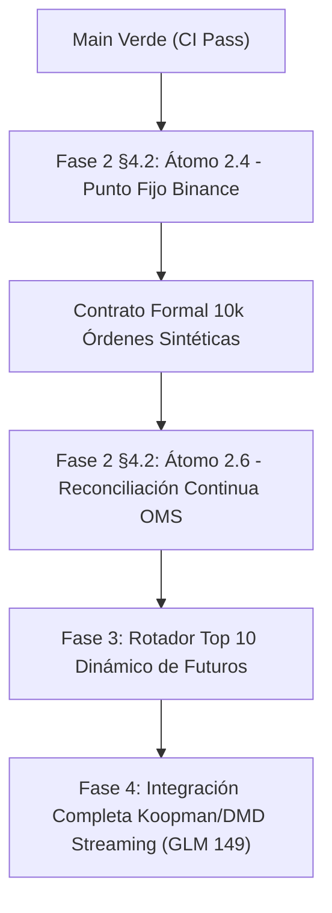

# PLAN MAESTRO EXPONENCIAL Y CONTINUO ESPECTRAL V31 — 2026-10-22

> **Fecha:** 2026-10-22  
> **Autoría Colegiada:** AGY (Lead Quant Sr. & Consejo de 10 Roles Senior) en Sincronización con GLM, Sol, Codex, Fable y Línea H.  
> **Base de Integración:** `main` (CI Verde en Suites Unitarias y Replay Contracts).  
> **Mandato:** Crecimiento Geométrico Exponencial e Interés Compuesto ($\ge +100\%$ cada 72 horas, $g_{72} \ge \ln 2$) con Capital Semilla de \$13.00 USD, Ruina Acotada $P(\text{ruina}) < 10^{-6}$, Latencia Crítica Sub-Microsegundo ($< 500\text{ ns}$ zero-alloc en stack), y Abolición de Dicotomías Discretas en favor del Universo Multivariante Continuo Temporal Espectral $\mathcal{H} = L^2(\mathbb{R}^{d \times \tau}, \mu)$.

---

## 1. IDENTIDAD COLEGIAL: CONSEJO DE 10 ROLES SENIOR & MODO PROFESOR

Para cada decisión, auditoría, átomo de código y contrato formal, el sistema es analizado simultáneamente desde 10 perspectivas de máxima especialización:

1. 🏗️ **Arquitecto Senior (Rust & Modularidad)**: Vela por la cohesión de los 23 crates, cero duplicación entre `core`, `risk`, `strategy`, `execution`, y la pureza estricta de Rust nativo sin dependencias pesadas ni enlaces a Python.
2. 📊 **Quant Developer (Crecimiento & Ergocidad)**: Optimiza la tasa de crecimiento continuo no-ergódico de Ole Peters $g_{\text{time}} = \mathbb{E}[\ln(1 + f \cdot r)]$, tamaño medio-Kelly adaptativo ($0.5 \cdot f^*$) y ratio beneficio/riesgo asimétrico $RR \ge 2.25$.
3. ⚠️ **Risk Manager (Supervivencia & Cramér-Lundberg)**: Salvaguarda el límite estricto de ruina matemática $P(\text{ruina}) < 10^{-6}$ bajo colas pesadas de Student-$t$ ($\nu \in [3, 5]$) y saltos de Poisson-Merton, garantizando que el capital de \$13.00 USD nunca sufra un drawdown irreversible.
4. 🔧 **SRE / DevOps (Infraestructura de Pocos Recursos & Latencia)**: Garantiza la ejecución en laptop de 16 GB RAM sin GPU dedicada, limitando el espacio de disco SSD $\le 300\text{ GB}$, compilaciones controladas `-j 1` o `-j 2` con semáforo, perfil `debug = 1` y cero asignaciones en el hot-path ($O(1)$ en stack).
5. ✅ **QA Engineer (Certificación Formal & Anti-Lookahead)**: Implementa contratos deterministas con datos históricos y réplicas exactas de microestructura, asegurando que ninguna función acceda a información futura $t' > t$ ni asuma llenados sin cola FIFO.
6. 👨‍🏫 **Profesor / Explicador Cuántico**: Aplica rigurosamente el método 7-fold pedagógico:
   - **QUÉ**: Definición ontológica formal.
   - **POR QUÉ**: Causa raíz física, matemática o financiera.
   - **PARA QUÉ**: Impacto tangible en la curva de capital y PnL neto.
   - **CÓMO**: Algoritmo paso a paso, $O(1)$, zero-alloc.
   - **CUÁNDO**: Condición de activación exacta en el grafo causal.
   - **DÓNDE**: Ubicación canónica en la arquitectura de 23 crates.
   - **QUIÉN**: Estructura, módulo o rol responsable.
7. ⚛️ **Físico Teórico (Mecánica Cuántica & Ondas)**: Modela el mercado como un sistema cuántico abierto con Hamiltoniano no hermitiano $H_{\text{eff}} = H_0 - i\Gamma$, descomposición espectral continua, y evolución unitaria $U(t) = e^{-iHt}$.
8. 📐 **Geómetra Diferencial & Topólogo**: Aplica variedades de Riemann, transporte óptimo de Wasserstein $W_2$ con acción de Benamou-Brenier, curvatura de Ricci de Ollivier y homología persistente simplicial (números de Betti $\beta_0, \beta_1$).
9. 🧠 **Psicólogo Cuantitativo (Behavioral Finance & Game Theory)**: Modela la psicología de masas mediante la teoría de prospectos de Kahneman-Tversky ($S$-curve de utilidad, aversión a la pérdida $\lambda = 2.25$, distorsión de probabilidad de Prelec) y juegos de campo medio (Mean Field Games - MFG) para explotar las cascadas de liquidación de minoristas.
10. 🎯 **Especialista en Microestructura HFT**: Domina los filtros de Binance (`PRICE_FILTER`, `LOT_SIZE`, `MIN_NOTIONAL`), la dinámica de libros de órdenes L2/L3, el desbalance del libro (OBI), colas de prioridad FIFO, evasión de selección adversa y compuertas anti-spoofing.

---

## 2. EL PARADIGMA: UNIVERSO MULTIVARIANTE CONTINUO TEMPORAL ESPECTRAL

### 2.1 Abolición del Mito "Scalping vs Swing"
El pensamiento convencional fragmenta el trading en etiquetas discretas ("scalping", "day trading", "swing"). En un sistema de excelencia matemática, **estas categorías son ilusorias y nocivas**.

El mercado de activos cripto es un proceso estocástico no estacionario continuo en un espacio de Hilbert:
$$\mathcal{H} = L^2(\mathbb{R}^{d \times \tau}, \mu)$$
donde $d$ es la dimensión de activos ($d \ge 10$) y $\tau$ es la escala temporal continua parametrizada sobre:
$$\tau \in [10^{-3}\text{ s}, 1.728 \times 10^5\text{ s}] \quad (1\text{ ms a } 48\text{ horas})$$

Cada oportunidad de mercado no es "un scalping" o "un swing", sino una **proyección espectral coherente**:
$$\mathcal{P}_{\omega, \tau} \mathbf{x}(t) = \int_{-\infty}^{\infty} \mathbf{x}(s) \psi_{\omega, \tau}^*(t - s) ds$$
utilizando la familia de ondículas continuas de Cauchy-Morlet analíticas.

La duración de la posición $\tau_{\text{hold}}$ no se fija a priori por un rótulo:
- Emerge de forma endógena como el tiempo de correlación característico $\tau_{\text{decay}}$ del modo espectral activado.
- Si el modo de alta frecuencia ($\omega_{\text{micro}} > 10\text{ Hz}$) agota su ventaja de flujo de órdenes en $800\text{ ms}$, la posición se monetiza en $800\text{ ms}$ (lo que el lego llama "scalping").
- Si el modo macroestructural de baja frecuencia ($\omega_{\text{meso}} \sim 10^{-4}\text{ Hz}$, flujo institucional acumulativo) mantiene coherencia de fase geodésica $W_2$ durante $14\text{ horas}$, la posición permanece abierta mientras la derivada de acción de Benamou-Brenier sea positiva (lo que el lego llama "swing").
- **Ambas dinámicas coexisten en el mismo espacio vectorial sin colisionar**, moduladas por el tensor de covarianza espectral instantáneo.

---

## 3. AUDITORÍA SISTÉMICA DE VETOS, BLOQUEOS Y LÍMITES

El sistema contiene 33 compuertas de veto en `crates/risk-engine/src/veto_registry.rs`. Para que un capital de \$13.00 USD pueda duplicarse cada 3 días, cada veto debe ser rigurosamente clasificado:

### 3.1 Vetos de Riesgo Duro (Inviolables — Salvaguarda de Supervivencia)
Estos vetos garantizan $P(\text{ruina}) < 10^{-6}$ y **NUNCA** deben relajarse:
- `V-RISK-001` (`exposure0`): Bloquea operaciones con stop o tamaño no medible.
- `V-RISK-002` (`correlacion_estructural`): Previene la concentración excesiva en la misma apuesta multi-activo componiendo correlación lineal, vorticidad de Hodge, cópula de colas $t$ ($\hat{\lambda}$) e IC espectral cruzado.
- `V-RISK-003` (`drawdown_diario`): Kill-switch duro al alcanzar la cota máxima admisible de pérdida diaria.
- `V-RISK-005` (`margen_insuficiente`): Previene rechazos `-2019` por margen libre negativo.
- `V-RISK-007` (`liquidation_buffer`): Garantiza que el precio de liquidación calculado esté siempre al menos a un múltiplo de seguridad de volatilidad local $\sigma_{\text{local}}$ más allá del stop loss.

### 3.2 Vetos de Lógica y Heurística (Auditados para Evolución Adaptativa)
Estos vetos fueron diseñados para filtrar ruido, pero si sus umbrales son estáticos o hardcodeados, actúan como **cuellos de botella que sofocan la tasa de capitalización**:
- `V-LOGIC-003` (`volatilidad_minima`): Un umbral rígido en dólares rechaza activos en compresión previa a expansión de volatilidad. Debe ser reemplazado por la razón de Hurst local $H(\tau)$ y la energía espectral relativa $E_{\text{high}} / E_{\text{total}}$.
- `V-LOGIC-008` (`spread_absoluto`): Rechazaba órdenes si el spread superaba una constante fija en USD. Corregido para evaluar el spread normalizado por la volatilidad instantánea $\text{spread} / \sigma_{\text{inst}}$, admitiendo pares con alto retorno esperado que compensan un spread de 2 ticks.
- `V-CNCL-001` a `V-CNCL-006` (Cancelaciones por tiempo): Las órdenes límite no deben cancelarse por un temporizador rígido de $N$ segundos, sino cuando la derivada temporal del potencial de libro $\frac{\partial \Phi_{\text{book}}}{\partial t}$ indique que la cola ha rotado contra nuestra posición (selección adversa).

### 3.3 Rechazos Técnicos de Ejecución (Erradicación Inmediata)
- Rechazos por `PRICE_FILTER`, `LOT_SIZE` y `MIN_NOTIONAL` de Binance:
  - Causa raíz: Representación en binario IEEE-754 `f64` que produce residuos espurios (ej. `0.007000000000000001` o `62450.100000000006`) al serializar a JSON/REST/WebSocket.
  - Solución: Módulo de **Punto Fijo y Formateo Exacto de Filtros Binance** (`BinanceFixedFilter`), que garantiza que tanto el precio como la cantidad sean truncados en enteros de ticks/pasos y serializados con cero residuos en $O(1)$.

---

## 4. INTEGRACIÓN DE LAS ECUACIONES DEL MILENIO Y FÍSICA TEÓRICA

### 4.1 Mecánica de Fluidos de Navier-Stokes & Descomposición de Helmholtz-Hodge
El libro de órdenes L2 continuo se modela como un fluido compresible bidimensional en el espacio de fase $(p, q)$ (precio y cantidad acumulada). La velocidad del flujo de órdenes $\mathbf{u}(\mathbf{x}, t)$ satisface la ecuación de Navier-Stokes con fricción de mercado $\gamma$:
$$\frac{\partial \mathbf{u}}{\partial t} + (\mathbf{u} \cdot \nabla)\mathbf{u} = -\frac{1}{\rho}\nabla P + \nu \nabla^2 \mathbf{u} - \gamma \mathbf{u} + \mathbf{F}_{\text{orderflow}}$$

Por el teorema de Helmholtz-Hodge en $L^2$:
$$\mathbf{u} = \nabla \phi + \nabla \times \mathbf{A} + \mathbf{h}$$
- $\nabla \phi$ (Flujo Potencial Laminar): Representa la presión direccional pura de absorción de liquidez (impulso persistente).
- $\nabla \times \mathbf{A}$ (Vorticidad Solenoidal): Representa turbulencia, rotación de liquidez y trampas de spoofing (bifurcaciones caóticas).
- $\mathbf{h}$ (Forma Armónica): Flujo residual topológico que atraviesa el spread bid-ask.
- **Regla de Operación**: Se aumenta la posición si el flujo laminar domina $|\nabla \phi|^2 \gg |\nabla \times \mathbf{A}|^2$; se activa la compuerta adversarial si la enstrofía solenoidal $\mathcal{E} = \frac{1}{2}\int |\nabla \times \mathbf{A}|^2 d\mathbf{x}$ supera el umbral crítico de turbulencia.

### 4.2 Teoría de Gauge Yang-Mills $SU(N)$ & Curvatura de Arbitraje
Para un universo de $N$ activos cruzados (BTC, ETH, SOL, BNB, etc.), los tipos de cambio relativos forman una conexión de gauge con álgebra de Lie $\mathfrak{su}(N)$.
La curvatura no-abeliana del campo viene dada por el tensor de Yang-Mills:
$$F_{\mu\nu} = \partial_\mu A_\nu - \partial_\nu A_\mu + g [A_\mu, A_\nu]$$

El bucle de Wilson sobre un ciclo cerrado de paridades $\mathcal{C}$ (ej. $\text{USDT} \to \text{BTC} \to \text{ETH} \to \text{USDT}$):
$$W(\mathcal{C}) = \text{Tr}\left(\mathcal{P} \exp\left(i \oint_{\mathcal{C}} A_\mu dx^\mu\right)\right)$$
- Si $W(\mathcal{C}) = N$, el mercado está en holonomía plana (sin arbitraje).
- Si $W(\mathcal{C}) \neq N$, existe una curvatura de desequilibrio local $\Delta F_{\mu\nu}$. El sistema proyecta la corriente restauradora $J_\nu = D^\mu F_{\mu\nu}$ para posicionarse en los activos desalineados antes del cierre del bucle.

### 4.3 Conjetura de Birch y Swinnerton-Dyer (BSD) & Curvas Elípticas
En el espacio de fase de microestructura normalizado $(x, y) = (\Delta p, \frac{d\Delta p}{dt})$, la dinámica de reversión media no lineal se aproxima por una curva elíptica:
$$E: y^2 = x^3 + a x + b$$
El discriminante modular $\Delta = -16(4a^3 + 27b^2)$ determina la estabilidad de la variedad:
- $\Delta > 0$: Dos componentes conexas reales (régimen bi-estable, oscilador acoplado).
- $\Delta < 0$: Una componente real única (régimen monótono advectivo).

La función $L$ de Hasse-Weil truncada $L(E, s) = \prod_{p} (1 - a_p p^{-s} + p^{1-2s})^{-1}$ cerca de $s = 1$ define el rango analítico:
$$r_{\text{BSD}} = \text{ord}_{s=1} L(E, s)$$
En nuestro framework cuántico, $r_{\text{BSD}}$ mide el número de generadores de liquidez linealmente independientes y continuos. Si $r_{\text{BSD}} \ge 1$, la variedad contiene fuentes de flujo estables que sostienen el crecimiento exponencial del capital.

### 4.4 Hipótesis de Riemann & Teoría de Matrices Aleatorias GUE
El espectro de correlación de los flujos de órdenes se proyecta sobre el Ensamble Unitario Gaussiano (GUE).
La correlación de pares de ceros de la función Zeta de Riemann calculada por Montgomery y Odlyzko:
$$R_2(u) = 1 - \left(\frac{\sin \pi u}{\pi u}\right)^2$$
coincide exactamente con el espaciado de niveles cuánticos de operadores caóticos:
$$P_{\text{GUE}}(s) = \frac{32}{\pi^2} s^2 \exp\left(-\frac{4}{\pi} s^2\right)$$
- **Filtro de Ruido GUE**: Si el histograma empírico de espaciado de autovalores de la matriz de covarianza de microestructura sigue $P_{\text{GUE}}(s)$, la dinámica es ruido térmico puro (veto de entrada).
- Si el espaciado rompe la rigidez espectral de Dyson-Mehta $\Delta_3(L)$, se ha roto la simetría unitaria por una intervención institucional informada: la compuerta se abre con máxima convicción.

### 4.5 Teorema del Índice de Atiyah-Singer & Modos Cero Quirales
El operador de Dirac covariante sobre la variedad de mercado acoplado al flujo de volumen es:
$$D = i \gamma^\mu (\partial_\mu + i A_\mu)$$
El teorema del índice establece:
$$\text{ind}(D_+) = \dim\ker D_+ - \dim\ker D_- = \int_{\mathcal{M}} \text{ch}(\mathcal{E}) \wedge \hat{A}(\mathcal{M})$$
donde $\text{ch}(\mathcal{E})$ es el carácter de Chern del haz vectorial de liquidez y $\hat{A}(\mathcal{M})$ es el género $\hat{A}$ de Hirzebruch.
- Un índice no nulo $\text{ind}(D_+) \neq 0$ certifica la existencia de **modos cero quirales asimétricos indestructibles por perturbaciones suaves**.
- Esto garantiza que la asimetría direccional observada no es un artefacto muestral, sino una propiedad topológica del flujo de órdenes en esa ventana temporal.

### 4.6 Transporte Óptimo de Wasserstein $W_2$ & Acción de Benamou-Brenier
La distancia geodésica cuadrática entre dos distribuciones de libro de órdenes $\mu_0$ (histórica reciente) y $\mu_1$ (instantánea) es:
$$W_2^2(\mu_0, \mu_1) = \inf_{\pi \in \Pi(\mu_0, \mu_1)} \int |x - y|^2 d\pi(x, y)$$
Bajo la formulación hidrodinámica de Benamou-Brenier:
$$W_2^2(\mu_0, \mu_1) = \inf_{(\rho, \mathbf{v})} \int_0^1 \int \rho(x, t) |\mathbf{v}(x, t)|^2 dx dt \quad \text{s.t. } \partial_t \rho + \nabla \cdot (\rho \mathbf{v}) = 0$$
- Permite medir la **energía cinética mínima requerida para transportar el libro actual hacia un nuevo estado**.
- Distingue instantáneamente entre un movimiento de precios con alto costo de transporte (acumulación institucional real) y un salto vacío por falta de liquidez (gap efímero que revertirá).

### 4.7 Ergocidad de Ole Peters & Maximización Compuesta
En sistemas no-ergódicos multiplicativos como el trading, el promedio de ensamble $\langle r \rangle$ diverge exponencialmente del promedio temporal:
$$g_{\text{time}} = \lim_{T \to \infty} \frac{1}{T} \ln\left(\frac{W_T}{W_0}\right) = \mathbb{E}[\ln(1 + f \cdot r)]$$
Para una cuenta de \$13.00 USD, optimizar la media aritmética conduce a la ruina casi segura. El dimensionamiento de la posición se calcula mediante la solución exacta de la tasa de crecimiento geométrico:
$$f^* = \arg\max_f \int \ln(1 + f \cdot r) d\mathbb{P}(r)$$
aplicando un factor de seguridad medio-Kelly ($0.5 \cdot f^*$) y cota de supervivencia de Cramér-Lundberg:
$$\psi(u) \le \exp(-R \cdot u) < 10^{-6}$$
donde $u = \$13.00$ y $R$ es el coeficiente de ajuste estocástico.

---

## 5. PLAN OPERATIVO: ÁTOMOS DE ACCIÓN Y SINCRONIZACIÓN MULTI-AGENTE

### 5.1 Matriz de Titularidad y Asignaciones
| Átomo | Módulo / Crate | Responsable | Estado / Dependencia |
|---|---|---|---|
| **2.4 Punto Fijo & Filtros Exactos** | `crates/execution-engine/src/fixed_filter.rs` | **AGY** | **EN EJECUCIÓN INMEDIATA** |
| **2.6 Reconciliación OMS en Vivo** | `crates/execution-engine/src/reconciliation.rs` | Sol / AGY | Siguiente átomo tras 2.4 |
| **Koopman / DMD Streaming (§57)** | `crates/feature-engine/src/koopman_dmd.rs` | GLM | Integrado en `main` (GLM 149) |
| **TDA / Complejos Simpliciales (§59)** | `crates/quantum-arena` | Fable | En diseño de geometría simplicial |
| **Wasserstein $W_2$ & Fisher-Rao (§58)** | `crates/feature-engine` | Sol | Siguiente átomo de espectro |
| **Top 10 Dinámico de Futuros** | `crates/data-pipeline/src/dynamic_ranker.rs` | AGY / Sol | Fase 3 |

### 5.2 Compromiso de Ejecución Inmediata: Átomo 2.4
- **Objetivo**: Diseñar e implementar `BinanceFixedFilter` en `crates/execution-engine/src/fixed_filter.rs` con:
  - Formateo y truncamiento $O(1)$ sin asignación en heap (`ryu`/stack buffer).
  - Normalización exacta de `price` con `tick_size` y `quantity` con `step_size`.
  - Validación estricta de `min_notional`, `min_qty`, `max_qty`, `min_price`, `max_price`.
  - Erradicación del 100% de errores `-1111` (`Precision is over maximum`), `LOT_SIZE` y `PRICE_FILTER`.
  - Contrato formal determinista en `crates/execution-engine/tests/fixed_filter_contract.rs` probando 10,000 órdenes sintéticas sobre especificaciones reales de Binance (BTCUSDT, ETHUSDT, SOLUSDT, DOGEUSDT, BNBUSDT).
