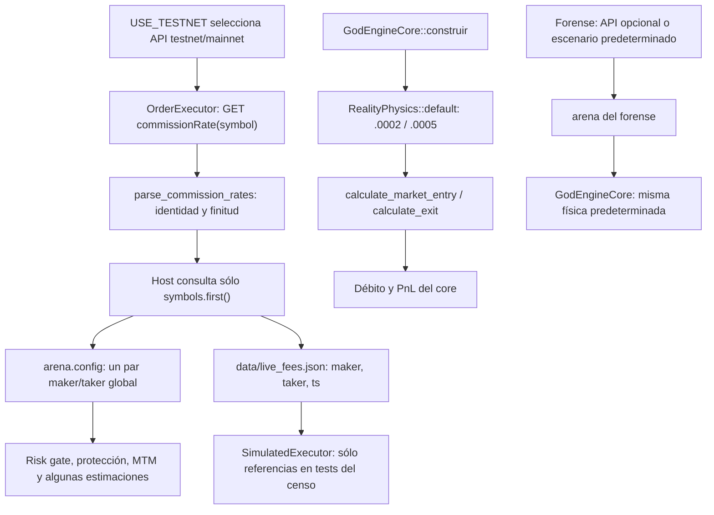

# QRA — relevo de comisiones observadas y cobro físico

Fecha: 2026-10-22. Revisor: quant_scope, con contraste independiente en lectura.
Corte histórico exacto: `7f4ee19196eff065e5fd001a92e40f1189e26e85`, candidato
PR97 anterior a los rebases sobre Omega218 y Sol F1-093. Frente al candidato
actual `911a4c863436783a3bc1e549a0b68f8ca0ae77a8`, basado en
`cf87f8cbc6d0fe3330e460f247dd2b38e9d990f2`, catorce de los quince blobs
siguen idénticos; sólo cambió el host. Sus anclas deben buscarse de nuevo.
`online_random_forest.rs`, modificado por Sol, no es `random_forest.rs`,
incluido en la tabla. Las rutas MPS nuevas de GLM 153 también están fuera
de estos quince blobs. El cotejo no certifica esos cambios ni el árbol completo.

El gate y el cobro físico separado conservan el hallazgo descrito en ese
código. La integración y los checks atribuibles a cada SHA se registran en
[el recibo de resultados](QRA_FASE2_RESULTADOS_2026-10-22.md); no se trasladan
resultados anteriores. Los contratos de relevo propuestos aquí siguen siendo
propuestas, distintas de los18 contratos QRA implementados y los4 Sol reparados.

Este documento revisa los caminos de tarifas indicados; no certifica los archivos
completos, el rendimiento financiero ni la paridad integral del sistema.
La revisión no ejecutó Cargo, backtests ni endpoints privados y no leyó credenciales.
Los contratos de integración de la sección 5 son propuestas para el dueño,
no pruebas escritas o ejecutadas en esta revisión documental.

**Prioridad para AGY/core:** el gate utiliza la comisión de `arena.config`, pero
el cobro de las entradas y salidas del core usa otro objeto con tasas
predeterminadas. QRA-FEE-01 valida la respuesta REST y su símbolo; no resuelve
esa separación. Host/OMS/core siguen reservados a sus dueños; este relevo sólo
añade documentación y no amplía el código de PR97 mientras corre su CI.

## 1. Evidencia reproducible del corte

Blobs obtenidos mediante `git ls-tree` sobre el corte histórico `7f4` anterior.
Las anclas de líneas de las secciones siguientes pertenecen a este corte y deben
buscarse de nuevo antes de editar.

| Ruta | Blob Git |
|---|---|
| `src/bin/god_engine.rs` | `6b5387816e9c5360cd27c51a9824b101935e984b` |
| `src/bin/audit_forensic_backtest.rs` | `1ccc2d24549dc5f00fe7e830616851b9e109a255` |
| `crates/execution-engine/src/executor.rs` | `c387fd92c25317962c7ce454b58cbf677158511e` |
| `crates/execution-engine/src/execution_evidence.rs` | `f7bfcac29520529638f50d66d82716744e59c242` |
| `crates/execution-engine/src/simulator.rs` | `e2cf6b5bf821d62c06ea3ffa63101460fb1aecc6` |
| `crates/god-engine-core/src/lib.rs` | `87d9f9e93cafad4919fa91f31d0ce0abbc164d9a` |
| `crates/god-engine-core/src/reality_physics.rs` | `462dfb19003f2daa5d528d8a2486bbbb1b4de7ec` |
| `crates/quantum-arena/src/config.rs` | `b9148c4bdf6980c7014998d522352092205e9252` |
| `crates/quantum-arena/src/symbol_registry.rs` | `22175c94f9e7dd2ccc7510cf5790a8dbb8d59076` |
| `crates/risk-engine/src/lib.rs` | `3aa1cfc3e0c98f45a203ad41a12bf73758023849` |
| `crates/risk-engine/src/tp_sl.rs` | `1e89c9dbcfa0de3ab837f9ad1f5ba9d4a5ac6b2e` |
| `crates/backtest-engine/src/booktick_replay.rs` | `25dc30bcc57b2ddb93ef14d4736499f465e45afa` |
| `crates/backtest-engine/src/lib.rs` | `652ebd8b74eafd9cc4c65e1d60ba0ac0c960dc56` |
| `crates/evolution-engine/src/online_daemon.rs` | `ca4d6fc0f6e71cf7f3b5727eb008dceab6ad086a` |
| `crates/evolution-engine/src/random_forest.rs` | `0f1bfe6010e26f0b394bfea702f7ab6ea457c95c` |

## 2. Grafo real de procedencia y consumo



No hay una arista de sincronización encontrada entre `arena.config.live_*_fee`
y `RealityPhysics.base_*_fee`. Una tasa válida en REST no demuestra qué tasa
descontará la física. El archivo tampoco conecta por sí mismo esos dos estados.

## 3. Hechos observados y riesgos delimitados

### 3.1 Gate y cobro físico conservan fuentes diferentes

El host selecciona entorno API en `src/bin/god_engine.rs:1383-1401`; el modo
papel/live es otra decisión (`:1417`). Consulta sólo `symbols.first()` en
`:1444-1446`. `executor.rs:4030-4065` selecciona el origen por `is_testnet`,
firma la petición y llama al parser de QRA-FEE-01. El parser en
`execution_evidence.rs:125` requiere el símbolo solicitado y tasas finitas;
conserva tasas finitas firmadas y no fija un tier económico.

El host publica el par en `arena_real.config` (`god_engine.rs:1969-1970` y
`:2254-2255`). El gate lee `live_taker_fee` en `risk-engine/src/lib.rs:927` y
lo pasa a la fricción canónica (`:995`): `2*taker + 2*slippage_por_lado`
en `risk-engine/src/tp_sl.rs:305-319`. El core también lee ese campo para
gestión/protección (`god-engine-core/src/lib.rs:4694-4753`).

Pero `GodEngineCore::construir` crea `RealityPhysics::default()` en
`god-engine-core/src/lib.rs:1530`. Ese objeto inicializa maker `0.0002` y taker
`0.0005` en `reality_physics.rs:27-33`. La búsqueda de `base_maker_fee` y
`base_taker_fee` en las fuentes Rust de `src/` y `crates/` sólo encuentra
definición, inicialización y lecturas en ese módulo: no un escritor desde el
arena. Es un censo estático de estas fuentes, no una afirmación sobre callers
externos al repositorio.

El cobro sí tiene consumidores reales:

- Entrada: `lib.rs:9970-9986` llama `self.reality.calculate_market_entry`,
  conserva `phys_entry_fee`, lo descuenta del capital en `:10046` y lo guarda
  en la posición (`:10063`).
- Salida: `lib.rs:5068` llama `self.reality.calculate_exit`; `:5148` usa
  `phys_exit_fee`; `:5214-5215` resta salida y entrada al construir PnL neto.

**Conclusión de wiring:** una observación taker `0.0004` puede llegar al gate
mientras el cálculo físico sigue usando `0.0005`. No se ha medido cuánto
cambia una corrida, una selección o el saldo real por esta diferencia. No se
atribuye una regresión de ROI a esta lectura.

### 3.2 Símbolo y entorno se pierden después de validar REST

La consulta valida el símbolo de una respuesta individual. El host publica
el mismo par global para todo el universo y no obtiene una tabla por símbolo.
No se encontró otro `fetch_commission_rate` del host al rotar símbolos o
recrear el ejecutor (`god_engine.rs:4185` y siguientes).

Que las tarifas efectivamente difieran entre dos símbolos o instantes es una
hipótesis a contrastar con observaciones autorizadas; no se presume esa
diferencia para esta cuenta. El contrato actual no puede representarla si
ocurre. La presencia de tasas por símbolo en `SymbolSpec` tampoco demuestra
paridad: el boot registra fichas predeterminadas (`god_engine.rs:1111-1115`,
`symbol_registry.rs:261-262`), sin rellenarlas con la respuesta recién obtenida.

Relevo propuesto: identificar cada snapshot con entorno API, símbolo,
identidad de cuenta no secreta, instante observado y procedencia; conservar
la distinción entre cuenta testnet/mainnet y ejecución papel/live. Antes de
usar una tasa para otra identidad o época, exigir evidencia explícita. No
copiar claves API ni secretos al snapshot o al log.

### 3.3 El archivo no certifica la paridad de los backtests actuales

En `god_engine.rs:1452-1463` se escribe la ruta relativa
`data/live_fees.json` con sólo `maker`, `taker` y `ts`. Se ignora el error de
escritura y se usa `std::fs::write`, sin protocolo atómico visible. La ruta
depende del CWD; no identifica entorno API, cuenta ni símbolo. Una escritura
concurrente/parcial o fallida podría dejar una lectura inválida o anterior;
eso es un riesgo de la implementación, no un incidente observado.

El único lector encontrado es `execution-engine/src/simulator.rs:12-35`:

- Exige `ts` entero y antigüedad calculada menor a siete días.
- `now.saturating_sub(ts)` considera fresco un timestamp futuro.
- Sólo toma `taker` numérico, finito y estrictamente positivo; cero o rebate
  finito terminan en el fallback `0.0005`, igual que error/ausencia/caducidad.
- No valida maker, identidad de entorno/símbolo/cuenta ni duplicados de
  campos; `serde_json::Value` elimina esa evidencia de duplicados.
- `SimulatedExecutor::fetch_commission_rate` ignora `_symbol` y devuelve
  maker fijo `0.0002` junto al taker leído (`simulator.rs:448-451`).

El censo de `SimulatedExecutor` en `src/` y `crates/` sólo halló su definición,
unit tests e integración `simulator_reduce_only_accounting_contract.rs`.
No halló un constructor operativo en host, forense o backtest. Sus métodos
de entrada/salida sí leen el archivo, pero sin caller operativo demostrado
no se atribuye ese archivo a resultados financieros actuales.

Los caminos operativos inspeccionados difieren:

- Forense: `audit_forensic_backtest.rs:310-330` sólo consulta REST con
  `FORENSIC_LIVE_FEES=1` y credenciales presentes; acepta API únicamente si
  maker y taker son positivos. Error, cero o rebate derivan al escenario
  `0.0002/0.0005`; no lee el archivo. Publica al arena en `:334-339`, pero la
  física independiente de 3.1 continúa. Su reporte `:797-800` estima salida
  con el taker del arena.
- Replay booktick: crea arena/core propios (`booktick_replay.rs:376-378`),
  lee tasas del arena con pisos `0.0002/0.0004` (`:391-401`) para estimar
  fees reportados; el PnL neto proviene del core (`:728-731`). No carga el
  archivo. El constructor de configuración fija `0.0002/0.0005`
  (`quantum-arena/src/config.rs:354-355`).
- Evolución: el prescreen lee el taker del padre (`online_daemon.rs:1785-1796`),
  pero `WfMarketEnv` sólo transporta spread/tick/leverage (`:222-235`) y el
  examen construye otra arena (`:658`). `ShadowForest::new` también crea
  arenas propias (`random_forest.rs:98-126`); tiene caller en
  `god_engine.rs:3498`. No se encontró transferencia de fees del padre a
  esas arenas. Una posible alteración de ranking/fitness queda sin medir.

## 4. Unidades y ecuación que debe conservar la integración

Para un contrato lineal con cantidad cerrada `q` en activo base, precios de
fill en moneda de liquidación por activo base y dirección `d=+1/-1`:

```text
N_k = |q_k| * P_fill,k                         [moneda de liquidación]
comisión_k = N_k * r_k                         [moneda de liquidación]
PnL_neto = d*q*(P_salida - P_entrada)
           - suma(comisión_k) - suma(funding_j)
```

`r_k` es una fracción adimensional por fill: `0.0004 = 4 bps = 0.04%`.
Comisión o funding positivo representa coste; negativo representa ingreso.
Para parciales se contabilizan fills y cantidades efectivamente casados;
no se usa dos veces el nocional de salida como sustituto de ambos fills.

Si `P_entrada` y `P_salida` son precios ejecutados, el diferencial de precios
ya incorpora el efecto de spread/slippage: no restarlo otra vez. Si la
comparación usa precios de referencia, el coste adverso frente a esa referencia
debe conciliarse aparte y una sola vez. La fricción previa del gate es una
estimación para decidir, no una segunda comisión a descontar del PnL.

Una comisión observada en otro activo no puede sumarse como USDT/USD sin
moneda, conversión y timestamp causales. La ecuación anterior presupone que
todos los importes ya están en la misma moneda; no certifica esa conversión.
QRA-FEE-01 preserva el signo finito, pero los fallbacks/pisos posteriores y
la contabilidad de fills requieren su propio contrato de moneda y signo.

## 5. Contratos negativos propuestos sobre consumidores reales

### A. Prioritario: tarifa del arena debe gobernar el débito del core

Usar `GodEngineCore` real y posición real del arena en
`OutcomeContext::IsolatedSimulation`; aprovechar el patrón de cierre por
stop de `god-engine-core/tests/cf5_freno_cierres.rs:50-69` o
`close_outcome_contract.rs:348-366`. Ambos llevan eventos al verdadero
`process_tick_dual`, no a una fórmula mock.

1. Crear dos fixtures idénticos con tasa observada taker `rA=0.0004` y
   `rB=0.0005`. No escribir manualmente `core.reality.base_taker_fee`: eso
   ocultaría precisamente la ausencia de wiring investigada.
2. Abrir una posición conocida con comisión de entrada explícitamente
   fijada e idéntica, disparar cierre taker por stop y exigir que realmente
   cierre. Invocar `process_tick_dual` con `allow_entries=false` y exigir
   ausencia de nueva entrada para aislar el cierre. Comparar comisión de
   salida y cambio de capital del core.
3. Aislar tasas con la rama real `EngineMode::Optimistic`, que mantiene el
   precio base, y nocional de salida conocido `N=1000` en moneda de
   liquidación. Expectativa: `feeA=0.40`, `feeB=0.50`; diferencia
   `N*(rB-rA)=0.10`, con signo opuesto en capital neto. Hoy la lectura del
   wiring predice la misma tasa física en ambos, aunque el arena difiera.
4. Repetir en `HyperRealistic` con eventos/semillas idénticos; verificar
   primero igualdad del precio y nocional usado por la física en el par.
   La diferencia de tasas no debe cambiar el slippage. Para expectativas
   basadas en fills, comprobar también cantidad redondeada y precio final:
   el nocional que el core pasa hoy a la física no debe suponerse idéntico
   al nocional final sin esa comprobación.
5. Actualizar la tasa después de construir el core y repetir con otra
   posición; un fix sólo en el constructor no demuestra refresco. Cubrir
   maker/taker de salida y la entrada real por `process_tick_dual`, exigiendo
   entrada admitida y observando `entry_fee` y capital en `:10046-10063`.
   La ruta de entrada puede cambiar sizing al cambiar la tasa; registrar
   el nocional de cada caso en vez de asumir que quedó igual.

Una prueba de `N*r` aislada, una aserción sobre el valor del arena o llamar
una física modificada manualmente no demuestra integración del consumidor.
Política de cero/rebate y observación inválida debe acordarse explícitamente:
preservar evidencia válida o rechazar el escenario, sin reemplazarla por
tarifas inventadas. Esto no autoriza aquí cambios de dominio económico.

### B. Identidad de símbolo/entorno y cargas de escenarios

- En el bootstrap real del host, un proveedor controlado devuelve tasas
  distintas para símbolos A/B. Permutar el universo no debe cambiar la tasa
  asociada a cada símbolo. Si B falla, no reutilizar la tasa de A como
  observación de B. El test debe demostrar que el bootstrap invoca ese
  proveedor y que el gate/cobro reciben las identidades correspondientes.
- Una observación testnet/A no satisface una petición mainnet/B. Cubrir
  también fecha futura, caducidad, escritura fallida y payload truncado en
  la carga real. El simulador requiere un contexto explícito para probar
  esta identidad; hoy su API no lo representa. Probar sólo un futuro helper
  de cache no certificará un binario que no lo llama.
- Para el forense solicitado en modo live, respuestas válidas `(0,0.0004)`
  y `(-0.0001,0.0004)` deben conservarse o generar rechazo explícito del
  escenario según política acordada; nunca anunciar paridad mientras se
  usa silenciosamente otro par. El camino de selección actual cae al
  escenario predeterminado y el mensaje de ese fallback sí es visible.
- En evolución, verificar que padre, control y candidatos reciben el mismo
  snapshot identificado antes del gate, del cobro y del MTM. Comprobar sólo
  igualdad del genoma o la función de fricción no prueba esa transferencia.

## 6. Relevo y límites de cierre

AGY conserva host/ejecución/core; coordinar cualquier bloque compartido con
Sol antes de modificarlo. Reservar primero el wiring de tarifas del core y
sus contratos, después procedencia por símbolo/entorno y cargas de escenarios.
La corrección del lector de archivo aislado no sustituye el primer paso.

Este relevo no implementa los contratos propuestos, no prueba uniformidad
de tarifas de la cuenta, no cuantifica diferencias de fitness/ROI y no
certifica que Demo, producción, replay y forense tengan ya la misma
contabilidad. El código QRA-FEE-01 bajo CI y este diagnóstico posterior son
alcances distintos.
