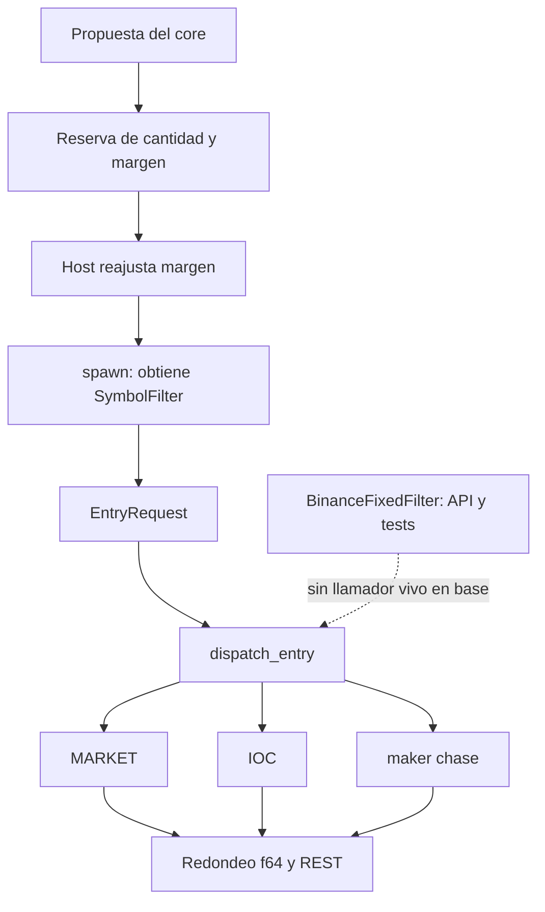

# Relevo QRA → AGY/OMS: orden preparada antes de reservar margen

22-Oct-2026, lectura del checkout compartido con modificaciones ajenas. Las
anclas son orientativas y deben buscarse de nuevo antes de editar. Este
documento no modifica ni certifica la implementación OMS en curso.
Hashes de contenido al observar el relevo (no son commits): executor
`9458e628f98c57b3c6a563a9f434ccf81860e4c2`, core
`87d9f9e93cafad4919fa91f31d0ce0abbc164d9a`, host
`6b5387816e9c5360cd27c51a9824b101935e984b`.

## Flujo observado

La línea punteada representa la conexión pendiente, no un enlace ejecutado.
`ws_executor.rs` es un stub; no acreditar envío WS porque exista su interfaz.

| Camino | Ancla observada |
|---|---|
| Host y margen | god_engine.rs:4760, 4824–4910; filtro dentro spawn:4945; EntryRequest:5011 |
| Despacho | entry_dispatch.rs:112, validación → leverage → submit_entry |
| MARKET | executor.rs:2222, cantidad; :2285, push_f64 |
| LIMIT / IOC | executor.rs:2772 / :3038, redondeo y serialización |
| Ruta alternativa | executor.rs:1480 build_payload; :2532 execute_order |
| Salidas | reduce-only MARKET:2401; ALGO:2113; trailing:3279; OCO:3373; flatten:800–922 |

Cambiar sólo `build_payload` no cubre la entrada principal. Cuantizar dentro
del spawn tampoco alinea la cantidad que ya quedó publicada en la reserva.

## Metadatos que faltan

`SymbolFilter` conserva step_size/tick_size/min_notional. `SymbolSpec` añade
min_qty, pero faltan min/maxPrice, maxQty, MARKET_LOT_SIZE, PERCENT_PRICE,
decimales originales, procedencia, entorno, timestamp y generación del
snapshot. `from_symbol_spec` del cuantizador usa techos de compatibilidad de
diez millones: no constituye un snapshot vivo completo del exchange.

`fetch_all_symbol_filters` (executor.rs:1646–1738) descarta esos campos y
emplea min_notional==5 como indicador de dato ausente; 5 también es un dato
válido. `dynamic_ranker.rs:143–185` completa ausencias con constantes y
convierte strings a f64. El boot publica especificaciones estáticas mediante
`get_official_binance_spec` (host:1111). Registrar presencia/validez por campo;
un número válido no puede indicar por sí solo si el dato se descargó.

## Secuencia para el siguiente átomo

1. Compilar fuera del hilo crítico un snapshot inmutable de filtros reales,
   identificado por símbolo, entorno y generación. Conservar decimales exactos.
2. Consultarlo antes de los cargos a capital/margen y publicación de posición
   del core (ancla leída lib.rs:10039). Sin filtro requerido no enviar entradas.
3. Preparar una sola intención con ruta, cantidad/precio decimales, identidad
   y generación. Para IOC BUY, calcular margen con el límite ejecutable;
   `current_price` puede ser menor que el precio límite de compra.
4. Reservar margen y comisión sobre esa cantidad definitiva. El reajuste de
   margen por sí solo no corrige una cantidad provisional ya publicada.
5. Transportar los mismos strings hasta firma y socket. Evitar otra
   cuantización posterior o conversión push_f64 de los campos preparados.
6. Al cambiar generación, revalidar o rechazar sin modificar silenciosamente
   intención y reserva. Ante timeout ambiguo, conservar identidad y conciliar.
   Ante rechazo local antes del socket, revertir únicamente la reserva propia.

La API f64 de QRA-01 aplica una cota conservadora exacta y puede bajar un lote
en fronteras decimales. Antes del cableado vivo, implementar y contrastar la
entrada decimal exacta evita perder esa información al principio del flujo.

## Prueba que cerraría la deuda

Ejecutar el adaptador real contra un transporte local capturador. Comparar
bytes firmados, cantidad de ranura, margen reservado e intención del registro.
Cubrir MARKET, IOC, maker/remanente parcial, filtros ausentes/corruptos,
cambio de generación, límites desalineados, paso 2.5, frontera 0.3, rechazo
local y timeout ambiguo. Los mocks de selección de ruta no prueban esos bytes.

Las salidas requieren su contrato: MARKET usa filtros propios y referencia
mark para nocional; el trigger de protección ALGO tiene dirección distinta
del precio límite. No elevar dust para alcanzar un mínimo ni bloquear una
reducción por un gate de edge de entradas. Validar flags por modo de posición
contra las [reglas oficiales USD-M](https://developers.binance.com/en/docs/products/derivatives-trading-usds-futures/common-definition).

Dueño propuesto del wiring: AGY (reserva OMS vigente). Codex QRA deja pruebas
del cuantizador y este relevo; ninguna ruta ajena se da por integrada por
actualizar el documento.
